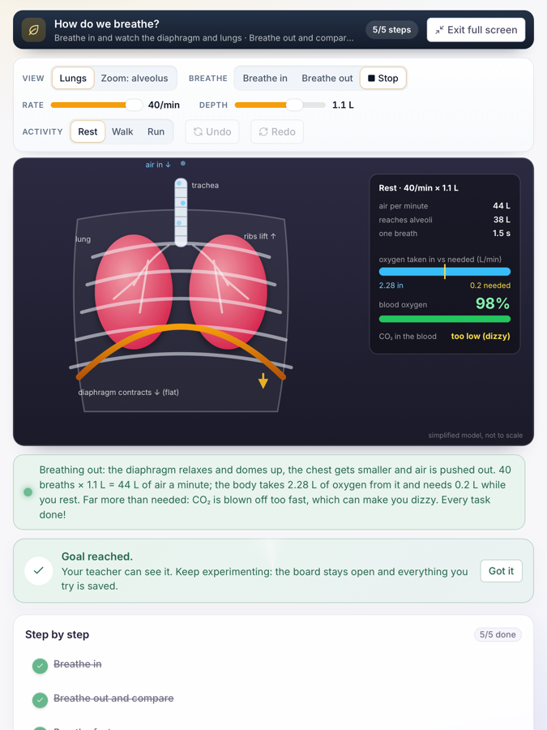
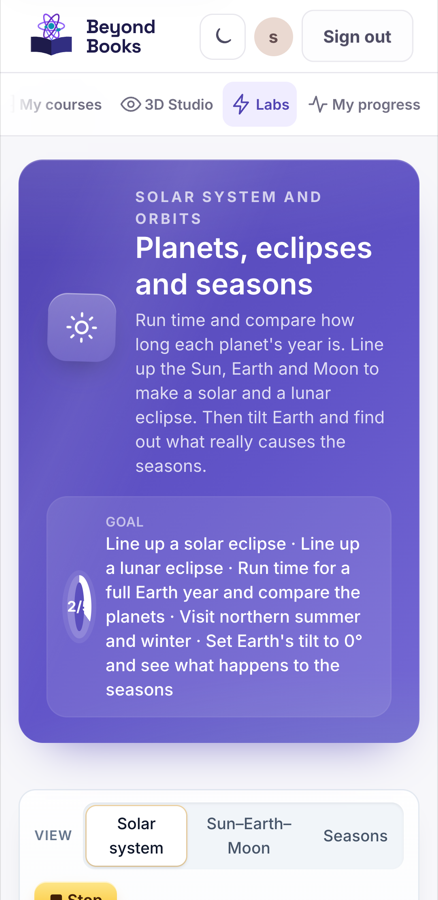
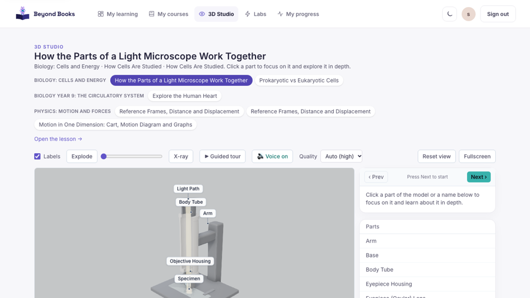
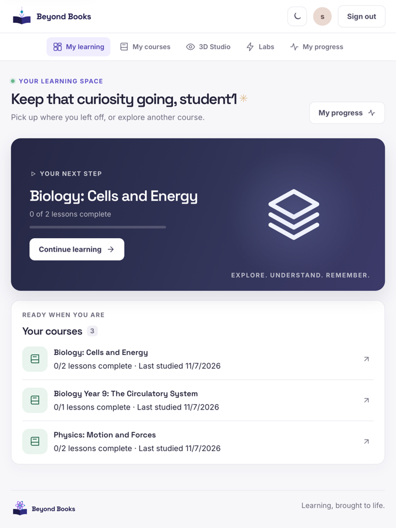

# Old-device check: usability, performance and security

Beyond Books, tested 2026-11-08 on the production build (vite preview) against the local backend.

## Summary

- **Devices:** 5 school-device profiles, 18 pages each (90 page visits).
- **Labs** run smoothly on every profile (lowest 56 fps; 60 is perfect), and full screen opened on 30 of 30 lab visits.
- **Security:** 25 of 28 checks pass; 3 to fix (see Security).
- **Biggest risks for schools:** blank screen for a minute or more when google fonts is slow or blocked; 3d is not usable without a decent graphics chip; very large 3d model files in the build.

| Device profile | Typical page ready | Slowest first paint | Lab smoothness | 3D | Verdict |
|---|---|---|---|---|---|
| Reference laptop (no limits) | 1.0 s | 0.3 s | 60+ fps | 60 fps | Good |
| Budget Chromebook (Celeron class, 1366×768, school Wi-Fi, weak GPU: software 3D) | 3.0 s | 1.7 s | 60+ fps | 3 fps | Good; 3D too slow |
| iPad 6th gen, Safari engine (WebKit, 768×1024, touch) | 1.0 s | 61.2 s | 56+ fps | 60 fps | Good, but blank screen on first visit |
| iPad 6th gen size and CPU (Chromium, 4× slower CPU, school Wi-Fi) | 2.9 s | 1.7 s | 60+ fps | 60 fps | Good |
| Low-end Android phone (360×740, 6× slower CPU, slow 4G) | 3.0 s | 2.3 s | 60+ fps | 60 fps | Good |

## Findings and fixes (most important first)

1. **[High] Blank screen for a minute or more when Google Fonts is slow or blocked**
   - What we saw: index.html loads its fonts with a render-blocking stylesheet from fonts.googleapis.com, so nothing is drawn until Google answers. Font experiment (first paint of the sign-in page): Chromium: 316 ms today, blank for over 90 s if Google is unreachable, 116 ms without Google; WebKit (Safari): 61.2 s today, blank for over 90 s if Google is unreachable, 98 ms without Google. In the device run, first paint took 33.8 s (ipad-safari, Landing page (animated)), 61.2 s (ipad-safari, Student home), 61.2 s (ipad-safari, Teacher home). Many school networks filter or slow Google, so pupils could see an empty page.
   - Fix: Self-host Inter and Space Grotesk (woff2 files in frontend/public/fonts with font-display: swap) and remove the Google links from index.html and the CSP. This also stops every visit sending the pupil's IP address to Google.
2. **[High] 3D is not usable without a decent graphics chip**
   - What we saw: chromebook: 3 fps (worst frame 1967 ms). With a real GPU the same scene runs at 60 fps (ipad-safari), 60 fps (ipad-slow), 60 fps (laptop), 60 fps (phone).
   - Fix: Detect weak or software WebGL (renderer string, first-second frame rate) and switch to a lighter mode: lower resolution (dpr 1), no shadows, render on demand only, or a still image with "Try 3D anyway".
3. **[High] Very large 3D model files in the build**
   - What we saw: plant_cell_v3.glb: 56.0 MB; plant_cell_v2.glb: 9.2 MB. Not opened by the pages in this test, but any page that uses them would take minutes on school Wi-Fi (56 MB ≈ 5 minutes at 1.5 Mbit/s).
   - Fix: Compress the models (gltf-transform: Draco or Meshopt geometry, KTX2/WebP textures, texture size 1–2K) to under 3 MB, and load them only when opened.
4. **[Medium] Some pages take over 6 seconds on slow devices**
   - What we saw: Lesson reader on chromebook: 8.2 s (996 KB); 3D Studio scene on chromebook: 7.2 s (943 KB); Lesson reader on ipad-slow: 7.7 s (996 KB); 3D Studio scene on ipad-slow: 6.9 s (944 KB); Lesson reader on phone: 17.1 s (788 KB); 3D Studio scene on phone: 7.0 s (944 KB)
   - Fix: Load the 3D viewer only when the pupil asks for it ("tap to load 3D") or when it scrolls into view, and keep the lesson text first.
5. **[Medium] A lab control reacts slowly on a weak phone**
   - What we saw: Lab: Build water, carbon dioxide and methane on phone: 1.6 s from tap to screen update (Add a hydrogen atom)
   - Fix: Profile that action on a throttled CPU; avoid re-evaluating or re-rendering the whole board on every change.
6. **[Medium] Accessibility problems (axe-core, WCAG 2.1 AA)**
   - What we saw: My progress: color-contrast (serious, 1)
   - Fix: Fix the listed rules (contrast, labels, names).
7. **[Medium] Pages freeze for a moment on a budget Chromebook**
   - What we saw: Lesson reader: 2.6 s blocked, longest 1.4 s; 3D Studio scene: 1.9 s blocked, longest 0.9 s
   - Fix: Split the heavy work (3D model parsing, big lists) or defer it until after the first paint.
8. **[Medium] Security: No third-party requests from pupils' browsers**
   - What we saw: index.html loads Google Fonts: every visit sends the pupil's IP address to Google (an issue under GDPR for schools, and blocked on some school networks)
   - Fix: Self-host the fonts (same fix as the blank-screen finding).
9. **[Low] On a phone held upright, the full-screen lab board is small**
   - What we saw: The board fills only 22–23% of a 360×740 screen (it is wide, the screen is tall).
   - Fix: In full screen on a portrait phone, show "Turn your phone sideways for a bigger board", or lock to landscape with screen.orientation.lock("landscape") where supported.
10. **[Low] Small touch targets on tablets and phones (under 24×24 px)**
   - What we saw: Lesson reader on ipad-safari: 26 (e.g. My courses, Biology: Cells and Energy, Exploded view amount, Auto (high)HighMediumLow); Lesson reader on ipad-slow: 25 (e.g. My courses, Biology: Cells and Energy, Exploded view amount, Arm); Lesson reader on phone: 20 (e.g. My courses, Biology: Cells and Energy, Exploded view amount, Epithelial cells); Landing page (animated) on ipad-safari: 11 (e.g. How it works, What you can do, Example, Sign in); Landing page (animated) on ipad-slow: 11 (e.g. How it works, What you can do, Example, Sign in); Teacher analytics on ipad-safari: 9 (e.g. Chemistry: Atoms, Molecules and IonsPhys, Chapter Quiz: Reference Frames, Distance, Review: Motion in One Dimension, Chapter Quiz: Reference Frames, Distance)
   - Fix: Give icon buttons, chips and close buttons at least 24×24 px (44×44 px is better for young pupils).
11. **[Low] Security: HTTPS enforced (Strict-Transport-Security)**
   - What we saw: missing (fine if the hosting/proxy in front adds it)
   - Fix: Add `Strict-Transport-Security: max-age=31536000` in nginx (or confirm the hosting proxy adds it).
12. **[Low] Security: No raw HTML injection in the frontend (XSS)**
   - What we saw: frontend/src/features/landing/HeroSubjects.tsx:57:      el.innerHTML = renderScene(scene, 0, STILL_ANGLE).replace(/url\(#g-/g, `url(#${uid}-`);; frontend/src/features/landing/HeroSubjects.tsx:64:      el.innerHTML = renderScene(scene, t, STILL_ANGLE + (t / period) * Math.PI * 2).replace(
   - Fix: Low risk today: the HTML comes from the app's own drawing code, not from users. Keep it that way, or render the SVG with React elements.

## Font experiment (why first visits can be blank)

First paint of the sign-in page in a fresh browser, three ways:

| Browser engine | Google Fonts as today | Google unreachable (school filter) | No Google (self-hosted fonts) |
|---|---|---|---|
| Chromium | 316 ms | blank for over 90 s | 116 ms |
| WebKit (Safari) | 61.2 s | blank for over 90 s | 98 ms |

## Page ready time by device

Time until the page finished loading and the network went quiet (lower is better). First paint in brackets when it was over 2 s.

| Page | laptop | chromebook | ipad-safari | ipad-slow | phone |
|---|---|---|---|---|---|
| Landing page (animated) | 0.8 s | 2.8 s | 34.5 s (33.8 s) | 2.8 s | 2.7 s |
| Sign-in page | 0.8 s | 2.6 s | 0.6 s | 2.5 s | 2.6 s |
| Student home | 1.0 s | 2.7 s | 62.2 s (61.2 s) | 2.6 s | 2.7 s |
| My courses | 1.0 s | 2.8 s | 1.0 s | 2.8 s | 2.9 s |
| Lesson reader | 1.7 s | 8.2 s | 2.3 s | 7.7 s | 17.1 s |
| Quiz | 0.6 s | 2.6 s | 1.0 s | 2.6 s | 2.7 s |
| My progress | 1.1 s | 3.0 s | 1.1 s | 2.9 s | 3.0 s |
| Labs list | 0.9 s | 2.7 s | 1.0 s | 2.7 s | 2.7 s |
| Lab: Planets, eclipses and seasons | 0.9 s | 3.0 s | 0.9 s | 2.9 s | 3.1 s |
| Lab: How do we breathe? | 1.0 s | 3.0 s | 1.0 s | 2.9 s | 3.0 s |
| Lab: Moving plates and earthquakes | 1.0 s | 3.0 s | 1.0 s | 2.9 s | 3.0 s |
| Lab: Build water, carbon dioxide and methane | 1.0 s | 2.9 s | 0.9 s | 2.9 s | 2.1 s (2.3 s) |
| Lab: Float or sink? | 1.0 s | 3.3 s | 1.0 s | 3.2 s | 3.3 s |
| Lab: Light the bulb | 1.0 s | 3.0 s | 1.0 s | 2.9 s | 2.9 s |
| 3D Studio scene | 1.1 s | 7.2 s | 1.1 s | 6.9 s | 7.0 s |
| Teacher home | 1.2 s | 3.7 s | 62.0 s (61.2 s) | 3.6 s | 3.6 s |
| Teacher labs | 1.0 s | 2.9 s | 1.0 s | 2.9 s | 2.9 s |
| Teacher analytics | 1.1 s | 3.5 s | 1.2 s | 3.3 s | 3.5 s |

## Labs on each device

Each lab was opened, one control was used (start the animation, add a part, change the object), the frame rate was measured for 3 seconds, then Full screen was opened and closed.

| Lab | Action | laptop | chromebook | ipad-safari | ipad-slow | phone |
|---|---|---|---|---|---|---|
| Planets, eclipses and seasons | Play the solar system | 60 fps, 171 ms, full screen ✓ (51% of screen) | 60 fps, 294 ms, full screen ✓ (46% of screen) | 58 fps, 90 ms, full screen ✓ (39% of screen) | 60 fps, 203 ms, full screen ✓ (39% of screen) | 60 fps, 238 ms, full screen ✓ (23% of screen) |
| How do we breathe? | Start breathing (Auto) | 60 fps, 84 ms, full screen ✓ (49% of screen) | 60 fps, 226 ms, full screen ✓ (48% of screen) | 56 fps, 83 ms, full screen ✓ (38% of screen) | 60 fps, 157 ms, full screen ✓ (38% of screen) | 60 fps, 168 ms, full screen ✓ (22% of screen) |
| Moving plates and earthquakes | Run the plates | 60 fps, 86 ms, full screen ✓ (51% of screen) | 60 fps, 190 ms, full screen ✓ (46% of screen) | 60 fps, 81 ms, full screen ✓ (39% of screen) | 60 fps, 221 ms, full screen ✓ (39% of screen) | 60 fps, 213 ms, full screen ✓ (41% of screen) |
| Build water, carbon dioxide and methane | Add a hydrogen atom | 60 fps, 85 ms, full screen ✓ (49% of screen) | 60 fps, 190 ms, full screen ✓ (48% of screen) | 60 fps, 78 ms, full screen ✓ (38% of screen) | 60 fps, 147 ms, full screen ✓ (38% of screen) | 60 fps, 1649 ms, full screen ✓ (22% of screen) |
| Float or sink? | Change the object to steel | 60 fps, 54 ms, full screen ✓ (49% of screen) | 60 fps, 83 ms, full screen ✓ (48% of screen) | 60 fps, 50 ms, full screen ✓ (38% of screen) | 60 fps, 68 ms, full screen ✓ (38% of screen) | 60 fps, 98 ms, full screen ✓ (22% of screen) |
| Light the bulb | Add a bulb | 60 fps, 92 ms, full screen ✓ (49% of screen) | 60 fps, 218 ms, full screen ✓ (48% of screen) | 60 fps, 85 ms, full screen ✓ (38% of screen) | 60 fps, 150 ms, full screen ✓ (38% of screen) | 60 fps, 249 ms, full screen ✓ (22% of screen) |

## Usability details

| Device | Data for first page | Pages wider than screen | Small touch targets (pages) | Browser errors |
|---|---|---|---|---|
| laptop | 256 KB | 0 | n/a (mouse) | 0 |
| chromebook | 255 KB | 0 | n/a (mouse) | 0 |
| ipad-safari | 392 KB | 0 | 77 (12 pages) | 4 |
| ipad-slow | 255 KB | 0 | 72 (12 pages) | 0 |
| phone | 255 KB | 0 | 58 (11 pages) | 0 |

Accessibility scan (axe-core, WCAG 2.1 AA) on 18 pages: 0 critical, 1 serious, 0 moderate issues.

## Security

| Area | Check | Result | Detail |
|---|---|---|---|
| Access control | Signed-out visitor cannot read labs | ✅ pass | GET /labs without a session → 401 |
| Access control | A valid student session works | ✅ pass | GET /users/me → 200 (student) |
| Access control | A tampered session token is rejected | ✅ pass | edited token signature → 401 |
| Access control | An unsigned (alg=none) token is rejected | ✅ pass | alg=none token → 401 |
| Access control | A student cannot see other students' lab activity | ✅ pass | student GET /labs/{id}/sessions → 403 |
| Access control | A student cannot edit a lab | ✅ pass | student PATCH /labs/{id} (empty change) → 403 |
| Access control | A student cannot create labs | ✅ pass | student POST /labs (invalid body) → 403 |
| Access control | A student cannot create courses | ✅ pass | student POST /courses (invalid body) → 403 |
| CSRF | Cookie requests without the app header are refused | ✅ pass | PATCH without X-Requested-With → 403 CSRF_CHECK_FAILED |
| CORS | Other websites cannot read the API with the pupil's cookies | ✅ pass | Origin https://evil.example → Access-Control-Allow-Origin: (none) |
| Sign-in | Wrong password and unknown email give the same answer (no account guessing) | ✅ pass | existing email → 401 "Invalid email or password.", unknown email → 401 "Invalid email or password." |
| Sign-in | Password guessing is slowed down (rate limit) | ✅ pass | blocked with 429 at attempt 11 |
| Headers (API) | API sends nosniff | ✅ pass | X-Content-Type-Options: nosniff |
| Headers (API) | API answers with personal data are not cached | ✅ pass | Cache-Control on /users/me: no-store |
| Headers (API) | API forbids framing / sets a referrer policy | ✅ pass | X-Frame-Options: DENY, Referrer-Policy: strict-origin-when-cross-origin |
| Cookies | Session cookie is HttpOnly (scripts cannot read it) | ✅ pass | set_cookie(..., httponly=True) |
| Cookies | Session cookie is SameSite=Lax | ✅ pass | set_cookie(..., samesite="lax") |
| Cookies | Production refuses to start without Secure cookies | ✅ pass | config validator rejects cookie_secure=False outside local |
| Headers (web, nginx) | Content-Security-Policy | ✅ pass | present |
| Headers (web, nginx) | Clickjacking protection (frame-ancestors / X-Frame-Options) | ✅ pass | present |
| Headers (web, nginx) | HTTPS enforced (Strict-Transport-Security) | ❌ low | missing (fine if the hosting/proxy in front adds it) |
| Headers (web, nginx) | Referrer-Policy | ✅ pass | present |
| Headers (web, nginx) | Permissions-Policy (camera/mic only where needed) | ✅ pass | present |
| Privacy | No third-party requests from pupils' browsers | ❌ medium | index.html loads Google Fonts: every visit sends the pupil's IP address to Google (an issue under GDPR for schools, and blocked on some school networks) |
| Code | No raw HTML injection in the frontend (XSS) | ❌ low | frontend/src/features/landing/HeroSubjects.tsx:57:      el.innerHTML = renderScene(scene, 0, STILL_ANGLE).replace(/url\(#g-/g, `url(#${uid}-`);; frontend/src/features/landing/HeroSubjects.tsx:64:      el.innerHTML = renderScene(scene, t, STILL_ANGLE + (t / period) * Math.PI * 2).replace( |
| Dependencies | Frontend packages: no high/critical known vulnerabilities | ✅ pass | npm audit: 0 critical, 0 high, 0 moderate, 0 low |
| Dependencies | Backend packages: no known vulnerabilities | ✅ pass | pip-audit: 98 packages, none affected |
| Access control | Cross-school / cross-pupil sweep over every API route (automated tests) | ✅ pass | 15 passed in 4.98s |

## Screenshots

**iPad (Safari engine), breathing lab in full screen**

**Low-end phone, astronomy lab**

**Budget Chromebook with software 3D**

**iPad (Safari engine), student home after the font timeout**

## How this was tested

| Profile | Browser engine | Screen | CPU | Network |
|---|---|---|---|---|
| Reference laptop (no limits) | Chromium, real GPU | 1440×900 | full speed | local |
| Budget Chromebook (Celeron class, 1366×768, school Wi-Fi, weak GPU: software 3D) | Chromium, software 3D (no GPU) | 1366×768 | 6× slower | 1.5 Mbit/s, 150 ms |
| iPad 6th gen, Safari engine (WebKit, 768×1024, touch) | WebKit (Safari's engine) | 768×1024 | full speed | local |
| iPad 6th gen size and CPU (Chromium, 4× slower CPU, school Wi-Fi) | Chromium, real GPU | 768×1024 | 4× slower | 1.5 Mbit/s, 150 ms |
| Low-end Android phone (360×740, 6× slower CPU, slow 4G) | Chromium, real GPU | 360×740 | 6× slower | 1.6 Mbit/s, 170 ms |

- Tool: `tools/device-check` (Playwright 1.65 with Chromium and WebKit, axe-core). Run `tools/device-check/check.sh` with the backend on :8000 and `npx vite preview --port 4173` in frontend/.
- Signed in as the seeded teacher and student with ordinary sessions. The run is read-only: every API write is blocked, so no progress, answers or settings were saved.
- Security probes send only empty or invalid changes, so nothing is modified even if a check fails.
- **Limits:** these are emulations on a Mac, not the real devices. WebKit on macOS is close to iPad Safari but not identical (no real iPad GPU or memory limits). CPU slowdown affects JavaScript, not the GPU, so the Chromebook profile uses software 3D as a stand-in for a weak GPU. A short check on one real old iPad and one real Chromebook is still recommended before a school pilot.
